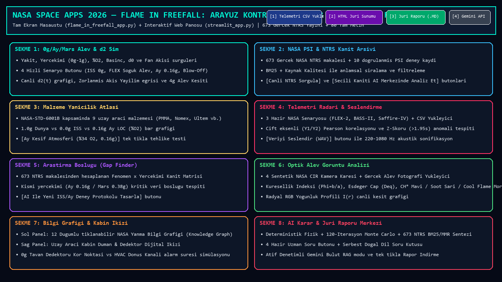
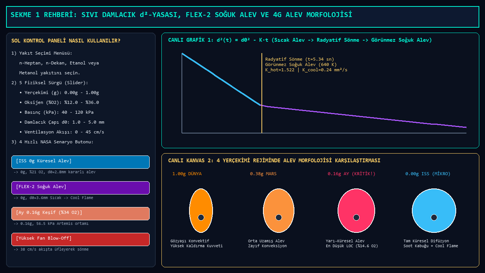
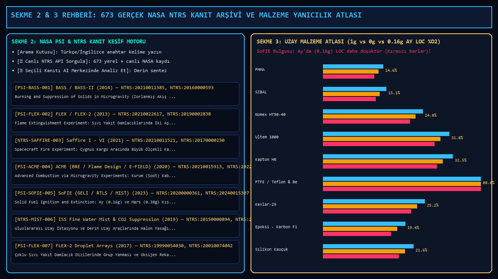
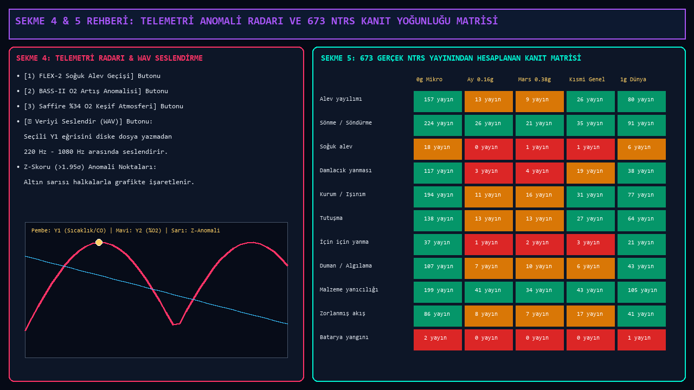
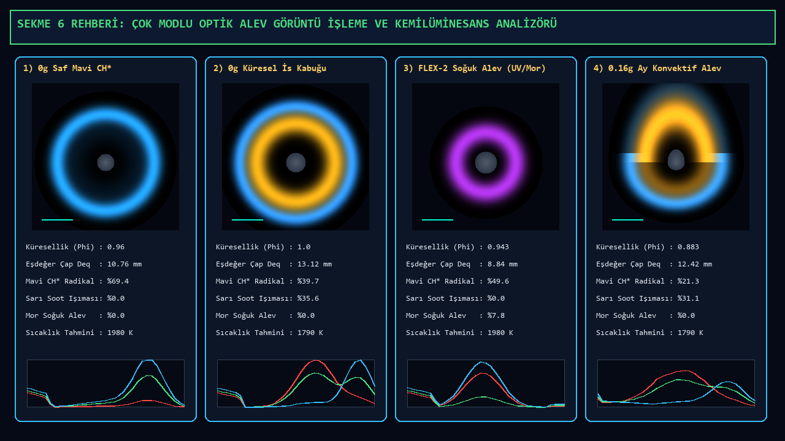
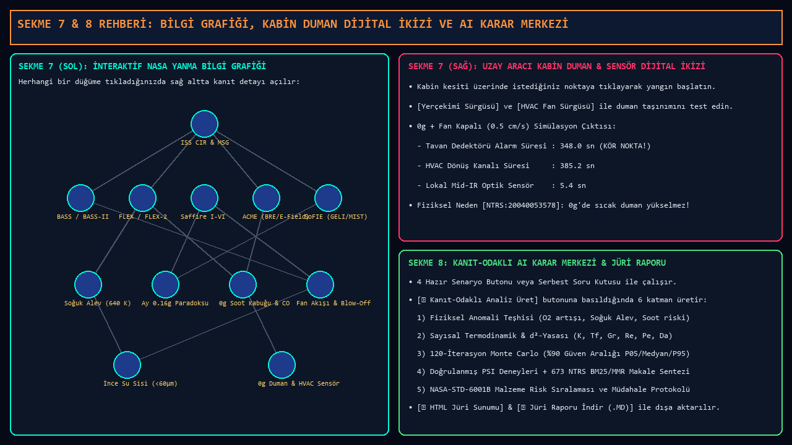

# 🔥 Flame in Freefall: AI-Powered Fire Safety Insights from Microgravity Combustion Data
**NASA Space Apps Challenge 2026 — Kapsamlı Teknik Dokümantasyon, Görsel Arayüz Kılavuzu ve Jüri Rehberi**

[](https://www.spaceappschallenge.org/2026/challenges/flame-in-freefall-ai-powered-fire-safety-insights-from-microgravity-combustion-data/)
[](https://ntrs.nasa.gov)
[](#)

Bu proje, NASA Space Apps Challenge 2026 **"Flame in Freefall: AI-Powered Fire Safety Insights from Microgravity Combustion Data"** yarışmasının tüm bilimsel ve mühendislik hedeflerini (**gerçek NASA açık verisi kullanımı, akıllı web panosu, yoğun teknik makaleleri özetleme ve sıralama, uzay aracı malzeme yanıcılık öngörüleri ve ISS / Artemis Ay / Mars görevleri için yangın güvenliği karar destek sistemi**) eksiksiz karşılamak üzere geliştirilmiştir.

---

## 🖼️ 1. Genel Mimari, Üst Kontrol Barı ve 8 Uzman Sekme Haritası



### 🎛️ Üst Kontrol Barındaki (Top Header Bar) Butonlar Ne İşe Yarar ve Nasıl Kullanılır?

| Buton Adı | Konumu | Ne İşe Yarar? | Nasıl Kullanılır? |
| :--- | :--- | :--- | :--- |
| **`📊 Telemetri CSV Yükle`** | Sağ Üst `[1]` | Bilgisayarınızdaki veya NASA PSI (`psi.nasa.gov`) arşivinden indirdiğiniz gerçek deney CSV dosyalarını **%100 salt-okunur** olarak belleğe yükler. | Butona tıklayın $\rightarrow$ `.csv` dosyanızı seçin. Otomatik olarak **Sekme 4 (Telemetri Radarı)** açılır, sayısal sütunlar algılanır, Pearson korelasyonu ve Z-skoru anomalileri çizilir. |
| **`🌐 HTML Jüri Sunumu`** | Sağ Üst `[2]` | Tüm sekmelerdeki aktif analizleri (AI Raporu, Monte Carlo, Malzeme Atlası, Araştırma Boşluğu, Optik Alev ve Kabin İkizi) **tek bir karanlık temalı interaktif `.html` panosuna** dönüştürür. | Butona tıklayın $\rightarrow$ Kayıt yerini seçin. Dosya kaydedilir ve **otomatik olarak varsayılan web tarayıcınızda açılır**. |
| **`💾 Jüri Raporu İndir (.MD)`** | Sağ Üst `[3]` | Kanıt-odaklı AI raporunu, NASA-STD-6001B malzeme değerlendirmesini ve araştırma boşluğu matrisini yapılandırılmış Markdown (`.md`) veya metin (`.txt`) belgesi olarak dışa aktarır. | Butona tıklayın $\rightarrow$ Dosya adını onaylayın. GitHub veya jüri teslim raporlarına doğrudan eklenebilir. |
| **`🔑 Gemini API`** | Sağ Üst `[4]` | İsteğe bağlı Google Gemini Bulut RAG sentezini etkinleştirir. **Boş bırakılırsa uygulama %100 çevrimdışı yerleşik BM25 + MMR + Fizik motoruyla çalışır.** | Butona tıklayın $\rightarrow$ `AIzaSy...` anahtarınızı girip **Kaydet**'e basın. |
| **`CPU & Uygulama RAM Göstergesi`** | Sağ Üst Köşe | Uygulamanın anlık işlemci yüzdesini ve yalnızca kendi kullandığı RAM miktarını (`MB` cinsinden, ~45–65 MB) gerçek zamanlı gösterir. | Otomatik olarak her 3 saniyede bir güncellenir. |

---

## 🔥 2. Sekme 1: Sıvı Damlacık $d^2$-Yasası, FLEX-2 Soğuk Alev ve 4g Alev Morfolojisi



### Ne İşe Yarar?
Mikroçekimde ($0g$), Ay'da ($0.16g$), Mars'ta ($0.38g$) ve Dünya'da ($1.0g$) sıvı yakıt damlacıklarının yanma fiziğini **$d^2$-Yasası** ($d^2(t) = d_0^2 - K \cdot t$), boyutsuz taşınımsal sayılar ($\text{Grashof}$, $\text{Reynolds}$, $\text{Peclet}$, $\text{Damköhler}$) ve NASA **FLEX / FLEX-2** deneylerinde keşfedilen **İki Aşamalı Yanma (Sıcak Alev $\rightarrow$ Radyatif Sönme $\rightarrow$ Görünmez Soğuk Alev / Cool Flame)** mekanizmasıyla simüle eder.

### Arayüzdeki Kontroller ve Butonlar Nasıl Kullanılır?
1. **`Yakıt Türü Seçimi` (Açılır Menü):**
   - `n-Heptan (C7H16 - FLEX Referansı)`, `n-Dekan (C10H22)`, `Etanol (C2H5OH)` veya `Metanol (CH3OH)` seçin. Ağır alkanlar (`n-Heptan`, `n-Dekan`) mikroçekimde büyük damlacık çaplarında ($d_0 \ge 2.1\text{ mm}$) görünmez **Soğuk Alev (Cool Flame)** fazına geçer.
2. **5 Fiziksel Parametre Sürgüsü (Sliders):**
   - **`Yerçekimi İvmesi (g)`:** `0.00g` (ISS) ile `1.00g` (Dünya) arasında kaydırın.
   - **`Oksijen Konsantrasyonu (%O2)`:** `%12.0` (sönme bölgesi) ile `%36.0` (keşif atmosferi) arasında değiştirin.
   - **`Kabin Basıncı (kPa)`:** `40 kPa` ile `120 kPa` arasında ayarlayın (`56.5 kPa` = NASA Exploration Atmosphere).
   - **`Başlangıç Damlacık Çapı d0 (mm)`:** `1.0 mm` ile `5.0 mm` arasında değiştirin.
   - **`Kabin Ventilasyon / Fan Hızı (cm/s)`:** `0.0 cm/s` ile `45.0 cm/s` arasında değiştirin. `35+ cm/s` üzerinde **Blow-Off (üfleyerek sönme)** tetiklenir.
3. **4 Hızlı NASA Senaryo Butonu (Sol Alt):**
   - **`🛰️ ISS 0g Küresel Alev`:** Standart ISS koşullarını ($0.00g$, $\%21\text{ O}_2$, $101.3\text{ kPa}$, $d_0=2.8\text{ mm}$) tek tıkla yükler.
   - **`🟣 FLEX-2 Soğuk Alev (Cool Flame)`:** Büyük n-Heptan damlacığında ($d_0=3.6\text{ mm}$, $0.00g$) görünür alevin radyatif ısı kaybıyla sönüp $640\text{ K}$ sıcaklıkta görünmez soğuk aleve geçişini gösterir.
   - **`🌙 Ay 0.16g Keşif (%34 O2)`:** Artemis/Lunar Gateway keşif atmosferini ($0.16g$, $\%34\text{ O}_2$, $56.5\text{ kPa}$) yükler.
   - **`💨 Yüksek Fan Blow-Off Sönmesi`:** Yüksek havalandırma hızında ($38\text{ cm/s}$) alevin nasıl üflenerek söndüğünü gösterir.

---

## 📚 3. Sekme 2 & Sekme 3: 673 Gerçek NASA NTRS Kanıt Arşivi ve Malzeme Yanıcılık Atlası



### Sekme 2: NASA PSI & NTRS Kanıt Veritabanı Nasıl Kullanılır?
- **`Arama Kutusu` ve `Yerçekimi Filtresi`:** Aramak istediğiniz terimi (ör. `cool flame`, `pmma`, `saffire`, `duman`, `ay`) yazın veya yerçekimi rejimini seçin; tablo anında **BM25 + önem puanına** göre sıralanır.
- **Tablodan Kayıt Seçimi:** Herhangi bir satıra tıkladığınızda sağ panelde deneyin tesis/görev bilgisi, oksijen/basınç/akış aralıkları, **tıklanabilir gerçek `https://ntrs.nasa.gov/citations/<ID>` referans adresleri**, temel bulgular ve yangın güvenliği çıkarımı görüntülenir.
- **`🌐 Canlı NTRS API Sorgula` Butonu:** Hem yerel **673 gerçek NTRS makalesi** içinde BM25 araması yapar hem de internet açıksa doğrudan `https://ntrs.nasa.gov/api` sunucusuna bağlanarak canlı NASA yayınlarını çeker.
- **`🤖 Seçili Kanıtı AI Karar Merkezinde Derin Analiz Et` Butonu:** Seçili deney kaydını otomatik olarak **Sekme 8 (AI Karar Merkezi)**'ne aktarır ve kapsamlı mühendislik raporu üretir.

### Sekme 3: Uzay Aracı Malzeme Yanıcılık Atlası (`NASA-STD-6001B`) Nasıl Kullanılır?
- **`Kabin Oksijen Oranı (%O2)` ve `Hedef Yerçekimi (g)` Sürgüleri:** Sürgüleri hareket ettirdiğinizde **9 uzay aracı malzemesinin** (*PMMA, SIBAL Kumaş, Nomex HT90-40, Ultem 1000, Kapton HN, PTFE Teflon, Kevlar-29, Epoksi-Karbon Kompozit, Silikon Kauçuk*) $1.0g$ Dünya, $0.0g$ ISS ve $0.16g$ Ay Kritik Oksijen Sınırı (**LOC %$\text{O}_2$**) grafiği ve sağdaki risk sıralaması canlı güncellenir.
- **`🌙 Ay Keşif Atmosferi (%34 O2, 0.16g)` Butonu:** Tek tıkla Artemis kabin koşullarını yükler ve Dünya'da güvenli görünen malzemelerin ($0.16g$ Ay kısmi yerçekimi paradoksu nedeniyle) nasıl yanıcı hale geldiğini gösterir.

---

## 📈 4. Sekme 4 & Sekme 5: Çok Eksenli Telemetri Radarı (WAV Seslendirme) ve Araştırma Boşluğu Matrisi



### Sekme 4: Çok Eksenli Telemetri Anomali Radarı & Veri Seslendirme (Sonification)
- **3 Hazır NASA Deney Telemetri Butonu:**
  - **`1) FLEX-2 Soğuk Alev Geçişi`:** Sıcak alevden radyatif sönmeye, görünmez soğuk alevde yüksek $\text{CO}$ birikimine ve yeniden tutuşma pikine geçiş telemetrisini yükler.
  - **`2) BASS-II O2 Artış Anomalisi`:** Kapalı modülde fan açılması / $\text{O}_2$ sızıntısı sonucu oksijen ve sıcaklığın eşzamanlı yükseldiği tehlike senaryosunu yükler.
  - **`3) Saffire %34 O2 Keşif Atmosferi`:** Büyük ölçekli Cygnus yangınında basınç ve radyatif ısı akısı pikini yükler.
- **`📂 CSV Dosyası Aç` Butonu:** Kendi CSV telemetri dosyanızı salt-okunur açar.
- **`Y1 Ekseni (Pembe)` ve `Y2 Ekseni (Mavi)` Menüleri:** Karşılaştırmak istediğiniz iki sensör kanalını seçin. Sistem otomatik olarak **Pearson korelasyon katsayısını ($r$)** ve **$Z > 1.95\sigma$ anomali noktalarını** (grafikte altın sarısı halkalarla) hesaplar.
- **`🔊 Veriyi Seslendir (WAV)` Butonu:** Görme engelli araştırmacılar veya hızlı işitsel anomali tespiti için seçili telemetri eğrisini **diske hiçbir dosya yazmadan (`io.BytesIO` bellek-içi 16-bit PCM WAV)** $220\text{ Hz} - 1080\text{ Hz}$ frekans aralığında seslendirir.

### Sekme 5: Derin Uzay Araştırma Boşluğu Bulucu (Research Gap Finder)
- **Sol Panel (Literatür Kapsama Isı Haritası):** `1.0g Dünya`, `0.0g ISS`, `0.16g Ay` ve `0.38g Mars` yerçekimi rejimlerinde 5 kritik yanma konusunun veri doygunluğunu renk kodlarıyla (🟩 Yüksek Veri, 🟨 Kısmi Veri, 🟥 Kritik Araştırma Boşluğu) gösterir.
- **Sağ Panel (Boşluk Listesi ve Deney Tasarımı):** Tablodan `GAP-LUNAR-01`, `GAP-COOL-02`, `GAP-DUST-03` veya `GAP-BATT-04` kaydına tıkladığınızda eksik parametreler ve **önerilen yeni ISS/Ay deney protokolü** listelenir.
- **`🤖 Seçili Boşluk İçin AI Deney Protokolü Üret` Butonu:** Seçili araştırma boşluğunu kapatmak için gerekli sensör, örnek boyutu ve atmosfer matrisini AI Karar Merkezinde detaylandırır.

---

## 📸 5. Sekme 6: Çok Modlu Optik Alev Görüntü İşleme & Kemilüminesans Analizörü



### Ne İşe Yarar ve Nasıl Kullanılır?
- **`📸 Sentetik NASA CIR Kamera Karesi` Menüsü:** NASA ISS *Combustion Integrated Rack (CIR)* yüksek hızlı kamera fiziğine göre modellenmiş 4 farklı alev görüntüsünden birini seçin:
  1. `1) ISS 0.00g — Küresel Mavi Difüzyon Alevi (Metanol / Düşük Kurum)`
  2. `2) ISS 0.00g — Küresel Sarı/Turuncu Soot Kabuklu Alev (n-Heptan / ACME)`
  3. `3) ISS 0.00g — FLEX-2 Görünmez Soğuk Alev (UV/IR False-Color 640 K)`
  4. `4) Ay 0.16g — SoFIE Kısmi Yerçekimi Konvektif Uzamış Alev`
- **`📂 Gerçek Alev Görüntüsü Yükle (.PNG/.JPG)` Butonu:** Bilgisayarınızdan gerçek bir deney fotoğrafı seçip piksel bazında analiz ettirebilirsiniz.
- **Otomatik Hesaplanan Görüntü İşleme Metrikleri:**
  - **Küresellik İndeksi ($\Phi = W / H$):** $\Phi \ge 0.86$ ise $0g$ küresel mikroçekim alevi, $\Phi < 0.85$ ise kaldırma kuvvetli (konvektif) alev olarak teşhis eder.
  - **Spektral Kemilüminesans Ayrıştırması:** Mavi $\text{CH}^*$ radikali emisyonu (%), Sarı/Turuncu kurum (soot) siyah cisim ışıması (%) ve Mor/UV **Soğuk Alev** formaldehit emisyonu (%) oranlarını hesaplar.
  - **Radyal RGB Yoğunluk Profili $I(r)$:** Alev merkezinden ($r=0\text{ mm}$) dış sınırına doğru Kırmızı (R), Yeşil (G) ve Mavi (B) ışık şiddeti dağılımını sağ üst kanvasta canlı çizer.

---

## 🛸 6. Sekme 7 & Sekme 8: İnteraktif Bilgi Grafiği, Kabin Dijital İkizi ve AI Karar Merkezi



### Sekme 7 (Sol Panel): İnteraktif NASA Yanma Bilgi Grafiği (Knowledge Graph)
- **Nasıl Kullanılır?** Kanvas üzerindeki **12 düğümden** (*ISS CIR Tesisi*, *BASS-II*, *FLEX-2*, *Saffire I-VI*, *ACME*, *SoFIE*, *Soğuk Alev*, *Ay 0.16g Paradoksu*, *0g Soot Kabuğu*, *Blow-Off*, *İnce Su Sisi*, *HVAC Sensörü*) herhangi birinin üzerine **farenizle tıklayın**.
- Tıkladığınız düğüm altın sarısı halkayla vurgulanır ve alt bilgi kutusunda o deneyin/fenomenin tüm nedensel bağlantıları ve kanıt kodları açıklanır.

### Sekme 7 (Sağ Panel): Uzay Aracı Kabin Duman & Dedektör Dijital İkizi
- **Nasıl Kullanılır?**
  - **`Yerçekimi (g)` ve `HVAC Akış (cm/s)` Sürgülerini** değiştirin veya **kabin kesiti kanvası üzerinde istediğiniz bir noktaya fareyle tıklayarak** yangın kaynağının yerini değiştirin.
  - Sistem [`NTRS:20040053578`](https://ntrs.nasa.gov/citations/20040053578) ve [`NTRS:20205003817`](https://ntrs.nasa.gov/citations/20205003817) kanıtlarına dayanarak **Tavan Dedektörü**, **HVAC Dönüş Kanalı Dedektörü** ve **Lokal Mid-IR Sensörün** alarm verme sürelerini saniye cinsinden hesaplar ve $0g$'de tavan dedektörünün neden kör noktada kaldığını görselleştirir.

### Sekme 8: Kanıt-Odaklı (Evidence-First) AI Karar Merkezi & Jüri Raporu Üretici
- **Nasıl Kullanılır?**
  1. **`🧠 Sentez Motoru` Menüsü:** `%100 Çevrimdışı Yerleşik Deterministik Kanıt & Fizik Motoru` veya `Google Gemini Bulut API + NASA PSI RAG Motoru` modunu seçin.
  2. **4 Hazır Uzman Senaryo Butonu:**
     - `🧪 1. ISS O2 Artışı & Fan Anomalisi`
     - `🟣 2. FLEX-2 Görünmez Soğuk Alev`
     - `🌙 3. Artemis Ay (0.16g) %34 O2 Paradoksu`
     - `🚿 4. ISS Halon Yasağı & Su Sisi`
     butonlarından birine tıklayın veya metin kutusuna kendi sorunuzu/telemetri değerlerinizi yazın.
  3. **`🔥 Kanıt-Odaklı Analiz Üret` Butonu:** Tek tıkla 6 bölümlü kapsamlı mühendislik raporu üretir:
     - **Bölüm 1:** Fiziksel Anomali ve Mikroçekim Yanma Teşhisi
     - **Bölüm 2:** Sayısal Termodinamik ve $d^2$-Yasası Simülasyon Çıktısı ($K$, $T_f$, $\text{Gr}$, $\text{Re}$, $\text{Da}$)
     - **Bölüm 2B:** 120-İterasyonlu Monte Carlo (%90 Güven Aralığı P05/Medyan/P95) & Sensör Dijital İkiz Analizi
     - **Bölüm 3:** Doğrulanmış NASA PSI Deneyleri (`https://ntrs.nasa.gov/citations/...` linkleriyle)
     - **Bölüm 3B:** **673 Gerçek NASA NTRS Akademik Korpusu BM25 + MMR Çıkarımsal Özet Cümleleri ve Makalelerden Çıkarılan Sayısal Bulgular**
     - **Bölüm 4 & 5:** Mevcut Atmosfer İçin `NASA-STD-6001B` Malzeme Değerlendirmesi ve Acil Müdahale Protokolü

---

## 🌐 7. Streamlit İnteraktif Web Panosu (`streamlit_app.py`) Kullanım Rehberi

Jürinin tarayıcı üzerinden doğrudan deneyimlemesi için geliştirilen `streamlit_app.py` 6 uzman sekmeden oluşur:

| Web Sekmesi | İçerdiği Özellikler ve Kullanımı |
| :--- | :--- |
| **📚 1. NTRS Literatür AI & Özetleyici** | 673 gerçek NTRS makalesinde Türkçe/İngilizce BM25 arama, program/yerçekimi filtresi, her cümlesi `[NTRS:ID]` linkli MMR çıkarımsal özet, makalelerden çıkarılan sayısal bulgular tablosu ve atıf denetimli Gemini sentezi. |
| **🔥 2. $d^2$-Yasası, Soğuk Alev & Monte Carlo** | Plotly interaktif $d^2(t)$ zaman serisi grafiği, BASS/SoFIE zorlanmış akış yayılım eğrisi ve 120-iterasyonlu Monte Carlo güven aralığı metrikleri. |
| **🧪 3. PSI CSV & $d^2$ Regresyon Laboratuvarı** | Gerçek NASA PSI CSV dosyası yükleyici, tutuşma geçişi kırpma sürgüsü, en küçük kareler $d^2(t) = d_0^2 - K \cdot t$ regresyonu ($K$, $d_0$, $R^2$, RMSE, %95 Student-$t$ güven aralığı) ve CSV dışa aktarma. |
| **🛡️ 4. Malzeme Yanıcılık Atlası** | 9 uzay aracı malzemesinin $1.0g$, $0.0g$ ve $0.16g$ Ay LOC (%$\text{O}_2$) gruplu Plotly bar grafiği ve dinamik risk tablosu. |
| **🔭 5. Kanıt Yoğunluğu & Araştırma Boşlukları** | 673 gerçek NTRS makalesinden otomatik hesaplanan *Fenomen × Yerçekimi Rejimi* Plotly Isı Haritası (Heatmap) ve kısmi yerçekimi araştırma boşluğu öncelik tablosu. |
| **📸 6. Optik Alev & Kabin Dijital İkizi** | CIR kamera küresellik ($\Phi$) ve $\text{CH}^*$/Kurum/Soğuk Alev spektral analizörü + kabin duman dedektörü tepki süresi simülatörü. |

---

## 🚀 8. Kurulum ve Çalıştırma Seçenekleri

### 📦 Tek Tıkla Bağımsız `.exe` Programı Oluşturma (PyInstaller Otomatik Derleyici):
Proje dizininde yer alan **`NASA_EXE_Olustur.bat`** dosyasına çift tıklayarak harici komut yazmaya gerek kalmadan tüm modülleri, fizik motorunu, CustomTkinter stil dosyalarını ve NTRS korpus verilerini otomatik sırayla `dist\NASA_Flame_In_Freefall\NASA_Flame_In_Freefall.exe` programına dönüştürebilirsiniz.

### ⚡ Tek Tıkla Çalıştırma (`NASA_Baslat.bat`):
- Derlenmiş bağımsız `.exe` mevcutsa doğrudan yüksek performansla başlatır.
- Henüz `.exe` derlenmemişse sistemdeki Python ortamı üzerinden masaüstü arayüzünü sıfır gecikmeyle açar.

### 💻 Terminal / Python ile Çalıştırma:
```bash
# 1) Gerekli kütüphaneleri yükleyin
pip install -r requirements.txt

# 2) Tam Ekran Masaüstü Karar Destek Platformunu başlatın (CustomTkinter - 8 Sekmeli)
python flame_in_freefall_app.py

# 3) İnteraktif Web Panosunu başlatın (Streamlit)
streamlit run streamlit_app.py

# 4) (İsteğe Bağlı) NASA NTRS Korpusunu ve Tam Metinleri Güncelleyin
python korpus_olusturucu.py --tam-metin --maks-tam-metin 80
```
